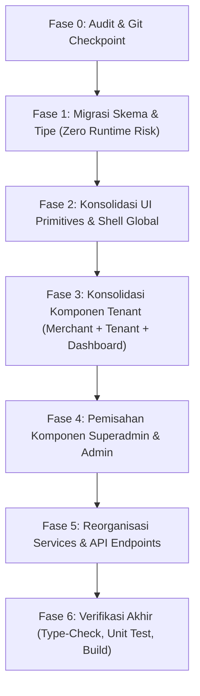

# DOKUMEN ANALISA STRUKTUR PROJEK: KONDISI TERKINI VS REKOMENDASI ARSITEKTUR

Sistem UMKM Site Builder SaaS (Pinoka)

---

> [!CAUTION]
>
> ## SYARAT MUTLAK & PERINGATAN INTEGRITAS (WAJIB DIBACA SEBELUM EKSEKUSI PEMINDAHAN)
>
> Proses restrukturisasi dan perapihan berkas **TIDAK BOLEH** dilakukan secara terburu-buru atau ceroboh. Kegagalan mematuhi aturan berikut akan menyebabkan bug fatal seperti _broken imports_, duplikasi berkas, inkonsistensi routing runtime, atau kegagalan build produksi:
>
> 1. **DILARANG COPY-PASTE (ZERO DUPLICATION GUARANTEE)**:
>    - Dilarang keras menyalin berkas (_copy-paste_) lalu membiarkan berkas lama tertinggal di folder asal. Setiap berkas yang dipindah **WAJIB** dipindahkan secara atomik menggunakan perintah `git mv <path_lama> <path_baru>` atau segera menghapus berkas lama pada operasi yang sama.
>    - Setelah pemindahan per folder selesai, lakukan audit pemindaian berkas duplikat berdasarkan hash isi berkas (bukan sekadar nama) untuk memastikan tidak ada 2 berkas identik di lokasi berbeda.
> 2. **ATURAN PEMBARUAN IMPORT PATH (NO BROKEN IMPORTS)**:
>    - Setiap pemindahan berkas harus diikuti pembaruan referensi import (`import ... from '...'`) pada seluruh berkas konsumen yang menggunakannya.
>    - Gunakan alias TypeScript terkonfigurasi (`@/*`, `@components/*`, `@lib/*`, `@services/*`, `@types/*`, `@db/*`) secara konsisten. Hindari path relatif bertingkat (`../../../../`) yang rapuh terhadap pergeseran hierarki folder.
>    - Setelah pemindahan tiap modul, jalankan type-check dan linting untuk mendeteksi import putus secara instan.
> 3. **PRESERVASI RUTE ASTRO & API CONTRACT**:
>    - Folder `src/pages/` terikat langsung dengan _File-based Routing_ Astro. Pemindahan berkas di dalam `src/pages/` akan mengubah URL publik browser dan endpoint HTTP API.
>    - Jika rute URL lama perlu dipertahankan demi backward-compatibility (misal webhook Xendit `/api/webhooks/xendit`, redirect BetterAuth `/api/auth/*`, atau bookmark `/dashboard`), wajib disediakan alias redirect Astro (`Astro.redirect`) atau _middleware rewrite_ agar klien lama tidak menerima respon 404.
> 4. **EKSEKUSI BERTAHAP PER MODUL TERISOLASI (PHASED EXECUTION)**:
>    - Dilarang memindahkan semua berkas sekaligus dalam satu waktu.
>    - Eksekusi **WAJIB** dibagi ke dalam modul terpisah (Contoh: Tahap 1: Schemas & Types, Tahap 2: UI Primitives & Shell, Tahap 3: Auth & Public, Tahap 4: Tenant & Merchant consolidation, Tahap 5: Admin & Superadmin split, Tahap 6: Services & API).
>    - Tiap modul selesai wajib di-_commit_ tersendiri di Git sehingga riwayat perubahan tercatat jelas dan aman di-_rollback_ jika ditemukan anomali.
> 5. **VERIFIKASI KETAT PASCA-PEMINDAHAN**:
>    - Jalankan perintah verifikasi berikut secara berurutan:
>      1. `bun run type-check` (Verifikasi tipe data TypeScript & Svelte tanpa error)
>      2. `bun run test:unit` (Memastikan test suite unit dan integrasi tetap hijau)
>      3. `bun run build` (Memastikan kompilasi bundle produksi Astro berhasil tanpa kendala)

---

## BAGIAN 1: ANALISA KRITIS & STRUKTUR FILE TERKINI (AS-IS)

### 1.1. Analisa Masalah Arsitektur Saat Ini

Berdasarkan audit mendalam terhadap seluruh struktur direktori di dalam `src/` (total 859 berkas), ditemukan beberapa kelemahan arsitektural fatal yang membuat proyek terlihat sangat berantakan, sulit dipelajari developer baru, dan rawan memicu duplikasi:

1. **Perpecahan Identitas Peran: "Merchant" vs "Tenant" vs "Dashboard"**:
   - Di dalam sistem, UMKM yang mendaftar disebut sebagai `tenant` pada database (`users.role = 'tenant'`), skema API (`/api/tenant/`), dan routing middleware.
   - Namun komponennya terpecah di 3 tempat yang sama sekali terpisah:
     - `src/components/merchant/ai/`: Berisi seluruh generator studio AI (Logo Wizard, Poster Wizard, Packaging Wizard).
     - `src/components/tenant/`: Berisi tabel produk (`ProductTable.svelte`) dan gauge kuota AI (`CreditQuotaGauge.svelte`).
     - `src/components/dashboard/`: Berisi kategori toko (`CategoryManager.svelte`), riwayat pesanan (`OrderHistoryTable.svelte`), dan galeri template toko (`TemplateGallery.svelte`).
   - Developer yang ingin mengelola fitur pedagang UMKM harus bolak-balik membuka 3 folder dengan penamaan yang tidak konsisten.

2. **Kerancuan Batas Wewenang: "Admin" vs "Superadmin"**:
   - Folder `src/components/superadmin/` hanya memiliki 6 berkas (hanya grafik transaksi dan ringkasan dashboard).
   - Sebaliknya, komponen inti pengelolaan platform level tertinggi justru menumpuk di `src/components/admin/`:
     - `AdminWhitelistPanel.svelte` (Whitelist email Google Superadmin)
     - `CommissionSettingsPanel.svelte` (Pengaturan fee % dan komisi platform)
     - `UserManagementPanel.svelte` (Kelola seluruh akun platform)
     - `TemplateCategoryManager.svelte` (Master kategori template)
     - `BusinessCategoryManager.svelte` (Master kategori bisnis UMKM)
     - `TemplateReviewPanel.svelte` & `TemplateReviewDashboard.svelte` (**Kurasi & review template desainer adalah tugas wewenang mutlak Superadmin**, tetapi selama ini ditaruh di `components/admin/`)
   - Hal ini membingungkan karena wewenang operasional Admin (supervisi merchant binaan, link registrasi merchant binaan) bercampur baur dengan kewenangan eksklusif Superadmin (pengaturan komisi platform, whitelist, kurasi template).

3. **Pencampuran Komponen Universal Shell dengan Fitur Tenant di `src/components/dashboard/`**:
   - Komponen shell global seperti `Sidebar.svelte`, `DashboardNavbar.svelte`, `NavbarNotifications.svelte`, dan `tour/` (yang dipakai bersama oleh Superadmin, Admin, Designer, dan Tenant) ditaruh di folder `src/components/dashboard/`.
   - Pada saat yang sama, folder `src/components/dashboard/` juga menampung tabel pesanan tenant, modal invoice tenant, dan modal template tenant. Ini melanggar prinsip _Single Responsibility Principle_ (SRP).

4. **Fragmentasi Skema Validasi di 5 Tempat Terpisah**:
   - Skema validasi formulir (Zod) tercecer tanpa aturan yang jelas:
     - `src/schemas/` (auth.schema.ts, admin/, designer/, finance/, templates/)
     - `src/lib/validators/` (ai-logo.ts, ai-packaging.ts, ai-poster.ts, subdomain.ts)
     - `src/lib/validation/bank-validate.schema.ts`
     - `src/lib/utils/validation.ts`
     - `src/lib/stores/schemas.ts`
   - Hal ini menyebabkan developer bingung mencari di mana letak skema validasi yang benar atau tidak sengaja membuat validasi duplikat.

5. **Inkonsistensi dan Redudansi Rute Halaman (`src/pages/`)**:
   - Ada berkas alias mengambang di root `src/pages/login.astro` dan `src/pages/register.astro` yang hanya me-redirect ke `/auth/login`.
   - Berkas aktivasi akun `src/pages/activation.astro` diletakkan di root `src/pages/`, padahal ini adalah domain proses otentikasi (`/auth/activation.astro`).
   - Halaman `src/pages/admin/ai-monitoring/index.astro` hanya berisi baris redirect ke superadmin.

6. **Ambiguitas Penempatan Komponen Bantu: `common/` vs `shared/` vs `ui/`**:
   - `src/components/shared/` hanya berisi 1 berkas (`ImageUpload.svelte`).
   - `src/components/common/` berisi komponen publik (Navbar, SmoothScroll) bercampur dengan filter periode dashboard (`PeriodFilter.svelte`).
   - `src/components/ui/` berisi atomik primitif (Button, Input, Card, Modal, dll).
   - Pembagian ini tidak tegas dan membingungkan.

---

### 1.2. Peta Struktur File & Folder Terkini (AS-IS)

Berikut adalah representasi struktur riil berkas dan folder saat ini:

```
umkm-site-builder/
├── src/
│   ├── components/                         # [559 files] Terfragmentasi & bercampur peran
│   │   ├── admin/                          # [61 files] Campuran fitur admin & superadmin
│   │   │   ├── ai/                         # Monitoring AI platform (sebenarnya superadmin)
│   │   │   ├── category/                   # Master kategori template
│   │   │   ├── commission/                 # Pengaturan komisi platform (sebenarnya superadmin)
│   │   │   ├── dashboard/                  # Dashboard metrik admin
│   │   │   ├── growth/                     # Metrik pertumbuhan
│   │   │   ├── merchants/                  # Pengawasan merchant binaan
│   │   │   ├── review/                     # Review template desainer (dulu di admin, sebenarnya wewenang superadmin)
│   │   │   ├── transactions/               # Tabel transaksi
│   │   │   ├── user/                       # Manajemen user (sebenarnya superadmin)
│   │   │   ├── whitelist/                  # Whitelist admin (sebenarnya superadmin)
│   │   │   ├── AdminAssistedStores.svelte
│   │   │   ├── AdminLocationMap.svelte
│   │   │   ├── AdminRegistrationPanel.svelte # Pembuat link registrasi
│   │   │   ├── AdminUserAddModal.svelte
│   │   │   ├── AdminUserDetailModal.svelte
│   │   │   ├── AdminUserSuspendModal.svelte
│   │   │   ├── AdminWhitelistPanel.svelte
│   │   │   ├── AuditLogTable.svelte
│   │   │   ├── BusinessCategoryManager.svelte
│   │   │   ├── CommissionSettingsPanel.svelte
│   │   │   ├── TemplateCategoryManager.svelte
│   │   │   ├── TemplateReviewDashboard.svelte
│   │   │   ├── TemplateReviewPanel.svelte
│   │   │   └── UserManagementPanel.svelte
│   │   ├── auth/                           # [7 files] Komponen form login, registrasi, OTP
│   │   │   ├── ActivationForm.svelte
│   │   │   ├── ForgotPasswordForm.svelte
│   │   │   ├── GoogleAuthButton.svelte
│   │   │   ├── LoginForm.svelte
│   │   │   ├── OtpInput.svelte
│   │   │   ├── RegisterForm.svelte
│   │   │   └── ResetPasswordForm.svelte
│   │   ├── builder/                        # [275 files] Template Builder Studio Desainer
│   │   │   ├── canvas/                     # Kanvas render, font loader, handles
│   │   │   ├── inspector/                  # Panel properti section & styling
│   │   │   ├── layer/                      # Panel tree layer & susunan node
│   │   │   ├── registry/                   # Registri modular section builder
│   │   │   ├── sections/                   # 104 layout presets (catalog, hero, faq, dll)
│   │   │   ├── stores/                     # Svelte stores kanvas & dokumen
│   │   │   ├── template-form/              # Form metadata template baru
│   │   │   └── topbar/                     # Header kontrol builder (undo/redo, save)
│   │   ├── checkout/                       # [5 files] Modal & rincian pembayaran
│   │   │   ├── CheckoutItemDetails.svelte
│   │   │   ├── CheckoutPaymentBreakdown.svelte
│   │   │   ├── CheckoutSummaryCard.svelte
│   │   │   ├── PaymentModal.svelte
│   │   │   └── TransactionStatus.svelte
│   │   ├── common/                         # [9 files] Campuran navbar publik & filter dashboard
│   │   │   ├── GlobalZoomControl.svelte
│   │   │   ├── Navbar.astro
│   │   │   ├── navbar.helpers.ts
│   │   │   ├── NavbarDropdown.svelte
│   │   │   ├── NavbarMobileDrawer.svelte
│   │   │   ├── NavbarUserMenu.svelte
│   │   │   ├── PeriodFilter.svelte
│   │   │   ├── PublicNavbar.svelte
│   │   │   └── SmoothScroll.svelte
│   │   ├── dashboard/                      # [29 files] Campuran universal shell & fitur tenant
│   │   │   ├── category/                   # Kategori toko milik tenant
│   │   │   ├── navbar/                     # Navbar universal dashboard
│   │   │   ├── orders/                     # Pesanan & invoice tenant
│   │   │   ├── sidebar/                    # Sidebar universal dashboard
│   │   │   ├── tour/                       # Universal interactive app tour
│   │   │   ├── CategoryManager.svelte      # Kategori produk tenant
│   │   │   ├── ChartWidget.svelte
│   │   │   ├── ConfirmTemplateModal.svelte
│   │   │   ├── CreditCheckoutModal.svelte
│   │   │   ├── DashboardNavbar.svelte
│   │   │   ├── OrderHistoryTable.svelte
│   │   │   ├── Sidebar.svelte
│   │   │   ├── TemplateGallery.svelte
│   │   │   └── TenantOrdersOverview.svelte
│   │   ├── designer/                       # [30 files] Portal desainer template
│   │   │   ├── DesignerBankCard.svelte
│   │   │   ├── DesignerBankModal.svelte
│   │   │   ├── DesignerMutationTable.svelte
│   │   │   ├── DesignerOrdersOverview.svelte
│   │   │   ├── DesignerPayoutHistoryTable.svelte
│   │   │   ├── DesignerTemplateTable.svelte
│   │   │   ├── DesignerWalletOverview.svelte
│   │   │   └── DesignerWithdrawModal.svelte
│   │   ├── directory/                      # [9 files] Direktori publik toko UMKM & map
│   │   │   ├── DirectoryMapView.svelte
│   │   │   ├── DirectoryStoreCard.svelte
│   │   │   └── LocationPermissionModal.svelte
│   │   ├── landing/                        # [17 files] Halaman depan marketing platform
│   │   │   ├── CtaSection.svelte
│   │   │   ├── FaqSection.svelte
│   │   │   ├── FeaturesSection.svelte
│   │   │   ├── HeroSection.svelte
│   │   │   ├── PricingSection.svelte
│   │   │   └── TestimonialsSection.svelte
│   │   ├── merchant/                       # [31 files] Generator AI pedagang UMKM (duplikasi peran tenant)
│   │   │   └── ai/                         # Logo wizard, poster wizard, packaging wizard
│   │   ├── onboarding/                     # [27 files] Wizard registrasi & setup awal toko tenant
│   │   │   ├── wizard/
│   │   │   ├── OnboardingWizard.svelte
│   │   │   └── onboarding.helpers.ts
│   │   ├── public/                         # [8 files] Komponen publik marketplace & direktori
│   │   │   ├── marketplace/
│   │   │   ├── PublicTemplateMarketplace.svelte
│   │   │   └── StoreDirectory.svelte
│   │   ├── settings/                       # [1 file] Pengaturan profil akun
│   │   │   └── AccountSettings.svelte
│   │   ├── shared/                         # [1 file] Hanya berisi 1 berkas
│   │   │   └── ImageUpload.svelte
│   │   ├── storefront/                     # [6 files] Komponen website dinamis toko UMKM
│   │   │   ├── DynamicSection.svelte
│   │   │   ├── Footer.svelte
│   │   │   ├── Hero.svelte
│   │   │   ├── PromoBanner.svelte
│   │   │   ├── StoreStatusBanner.svelte
│   │   │   └── StorefrontDynamicPage.svelte
│   │   ├── superadmin/                     # [6 files] Terlalu sedikit, padahal superadmin punya wewenang besar
│   │   │   ├── dashboard/
│   │   │   └── SuperadminTransactionsOverview.svelte
│   │   ├── tenant/                         # [14 files] Fitur tenant tapi terpisah dari merchant/ & dashboard/
│   │   │   ├── ai/                         # CreditQuotaGauge, MutationTable, UsageChart
│   │   │   ├── product/                    # ProductVariantEditor, ProductBasicFields
│   │   │   ├── ProductDeleteModal.svelte
│   │   │   ├── ProductFormModal.svelte
│   │   │   ├── ProductTable.svelte
│   │   │   └── ProductTableRow.svelte
│   │   ├── tokens/                         # [7 files] Design system tokens
│   │   │   ├── animations.ts, colors.ts, radius.ts, shadows.ts, spacing.ts, typography.ts
│   │   └── ui/                             # [16 files] Primitif UI atomik (Button, Input, Card, Modal, dll)
│   │
│   ├── pages/                              # [148 files] File-based routing Astro & API
│   │   ├── admin/                          # [7 files] Rute dashboard admin
│   │   │   ├── ai-monitoring/index.astro   # Hanya redirect ke superadmin
│   │   │   ├── merchants/index.astro
│   │   │   ├── registrations/index.astro
│   │   │   ├── transactions/index.astro
│   │   │   ├── audit-logs.astro
│   │   │   ├── index.astro
│   │   │   └── wallet.astro
│   │   ├── api/                            # [85 files] HTTP endpoints backend
│   │   │   ├── admin/                      # [26 files] Campuran endpoint admin & superadmin
│   │   │   ├── ai/                         # [2 files] AI generate
│   │   │   ├── analytics/                  # [1 file] Track event
│   │   │   ├── auth/                       # [6 files] BetterAuth & check-email
│   │   │   ├── builder/                    # [1 file] Save builder draft
│   │   │   ├── categories/                 # [1 file]
│   │   │   ├── designer/                   # [6 files] Bank, payout, templates
│   │   │   ├── directory/                  # [1 file] UMKM search
│   │   │   ├── media/                      # [2 files] Cloudinary sign & delete
│   │   │   ├── merchant/                   # [1 file] products endpoint (bercampur dengan tenant)
│   │   │   ├── notifications/              # [4 files]
│   │   │   ├── products/                   # [4 files] Direct product endpoints
│   │   │   ├── public/                     # [7 files]
│   │   │   ├── storefront/                 # [1 file]
│   │   │   ├── stores/                     # [9 files] Subdomain & store details
│   │   │   ├── templates/                  # [1 file]
│   │   │   ├── tenant/                     # [11 files] AI credits, quota, transactions
│   │   │   └── webhooks/                   # [1 file] Xendit webhook
│   │   ├── auth/                           # [4 files] Rute otentikasi (/auth/login, /auth/reset-password, dll)
│   │   ├── builder/                        # [5 files] Rute builder studio desainer
│   │   ├── checkout/                       # [1 file] /checkout/[invoiceId].astro
│   │   ├── dashboard/                      # [12 files] Portal tenant (/dashboard/products, /orders, dll)
│   │   ├── designer/                       # [4 files] Portal desainer (/designer/templates, /wallet, dll)
│   │   ├── onboarding/                     # [1 file] Setup toko tenant
│   │   ├── settings/                       # [1 file] Pengaturan akun
│   │   ├── storefront/                     # [2 files] Pratinjau storefront & subdomain
│   │   ├── superadmin/                     # [10 files] Portal superadmin
│   │   ├── templates/                      # [1 file] Marketplace publik template
│   │   ├── 401.astro, 403.astro, 404.astro # Error handling pages
│   │   ├── activation.astro                # Mengambang di root (seharusnya di auth/)
│   │   ├── contact.astro, help.astro       # Halaman bantuan publik
│   │   ├── index.astro                     # Landing page utama
│   │   ├── login.astro, register.astro     # Berkas alias redirect redundan
│   │   ├── privacy.astro, terms.astro      # Legal pages
│   │   ├── umkm.astro                      # Direktori publik toko UMKM
│   │   └── robots.txt.ts, sitemap.xml.ts   # SEO endpoints
│   │
│   ├── services/                           # [46 files] Business logic layer
│   │   ├── ai/                             # Logic AI generator, router, capacity
│   │   ├── business-categories/            # Kategori usaha UMKM
│   │   ├── finance/                        # Transaksi, payout, invoice, wallet
│   │   ├── media/                          # Cloudinary uploader & sync
│   │   ├── stores/                         # Store & subdomain logic
│   │   ├── template-categories/            # Kategori template
│   │   ├── templates/                      # Kurasi & metadata template
│   │   ├── ai-credit.service.ts
│   │   ├── analytics.service.ts
│   │   ├── audit.service.ts
│   │   ├── store-template.service.ts
│   │   └── visitorLimit.service.ts
│   │
│   ├── schemas/                            # [18 files] Skema validasi Zod terfragmentasi
│   │   ├── admin/, designer/, finance/, templates/
│   │   └── auth.schema.ts
│   │
│   ├── lib/                                # [48 files] Campuran utils, integrasi 3rd party, & validator
│   │   ├── validators/                     # [5 files] Seharusnya ada di schemas/
│   │   ├── validation/                     # [1 file] Seharusnya ada di schemas/
│   │   ├── auth/                           # Permissions & auth core
│   │   ├── db/                             # Client DB & transaction
│   │   ├── finance/                        # Idempotency & Xendit client
│   │   ├── security/                       # Prompt sanitizer
│   │   └── utils/                          # Api-handler, math, logger, rate-limiter
│   │
│   ├── types/                              # [24 files] TypeScript interfaces
│   ├── layouts/                            # [3 files] BaseLayout, DashboardLayout, StorefrontLayout
│   ├── db/                                 # [3 files] client.ts, schema.ts, seed.ts
│   ├── config/                             # [1 file] app.ts
│   ├── styles/                             # [6 files] Global CSS, typography, components
│   └── middleware.ts                       # [1 file] Route guard, auth, subdomain rewriter
```

---

## BAGIAN 2: STRUKTUR FILE REKOMENDASI (TO-BE) - ROLE & GOAL BASED

### 2.1. Filosofi Restrukturisasi

Struktur rekomendasi dirancang berdasarkan prinsip **"Clear Ownership by Role and Goal"**:

1. **Pemisahan Peran yang Tegas**:
   - `auth/`: Segala hal terkait login, pendaftaran, verifikasi, dan reset kata sandi.
   - `public/`: Antarmuka pengunjung umum (Landing page, direktori UMKM, marketplace publik template, checkout publik).
   - `storefront/`: Website e-commerce toko pedagang yang diakses pembeli via subdomain.
   - `superadmin/`: Pusat kontrol eksklusif pemilik platform (Pengaturan fee/komisi, whitelist email Google, audit logs global, AI monitoring global, master kategori, serta **kurasi & review template desainer**).
   - `admin/`: Pusat operasional staf admin (Supervisi merchant binaan, link registrasi merchant binaan, assisted stores & peta lokasi, admin wallet).
   - `designer/`: Workspace desainer template independen (Koleksi template, penjualan, dompet penghasilan, pengajuan penarikan dana).
   - `builder/`: Template Builder Studio (Kanvas WYSIWYG, panel layer, inspektor, registry 104 preset seksi).
   - `tenant/`: Portal terpadu pemilik toko UMKM (Menyatukan `merchant/`, `tenant/`, dan fitur toko di `dashboard/`: manajemen produk, kategori toko, pesanan pembeli, AI Studio Creative suite, dan saldo kuota AI).
2. **Universal Shell yang Terisolasi (`shell/`)**:
   - Memindahkan `Sidebar`, `DashboardNavbar`, notifikasi, dan tour dari `dashboard/` ke folder `shell/`. Shell ini dipakai bersama oleh Superadmin, Admin, Designer, dan Tenant tanpa mencemari logika spesifik salah satu role.
3. **Sentralisasi Validasi Formulir (`schemas/`) vs Database Schema (`db/schema.ts`)**:
   - **Skema Database (`src/db/schema.ts`)**: **TETAP 1 FILE TUNGGAL** (tidak dipecah). Menjadi _Single Source of Truth_ definisi tabel Drizzle ORM agar relasi, foreign keys, dan migrasi mudah diaudit dalam satu tempat.
   - **Skema Validasi Runtime (`src/schemas/`)**: Seluruh skema validasi form Zod dari `src/lib/validators/` dan `src/lib/validation/` ditarik dan disatukan ke dalam `src/schemas/` dengan subfolder sesuai role dan domain bisnis.
4. **Sentralisasi UI Primitives & Tokens (`ui/` & `tokens/`)**:
   - Menggabungkan komponen umum (`common/` dan `shared/`) ke dalam `ui/` (seperti `ImageUpload`, `PeriodFilter`, `ZoomControl`). Folder `common/` dan `shared/` dihapus tuntas untuk menghilangkan ambiguitas.
5. **Konsistensi Rute & API**:
   - Penyatuan endpoint merchant dan tenant di bawah payung `/api/tenant/`.
   - Menghilangkan file alias redirect redundant di `src/pages/` dan merapikan halaman error/aktivasi.

---

### 2.2. Peta Hierarki Rekomendasi (TO-BE Structure)

```
umkm-site-builder/
├── src/
│   ├── components/                         # Komponen UI modular berdasarkan ROLE & TUJUAN
│   │   │
│   │   ├── auth/                           # [ROLE: SEMUA] Otentikasi & Akun
│   │   │   ├── ActivationForm.svelte       # Form aktivasi akun undangan
│   │   │   ├── ForgotPasswordForm.svelte   # Form lupa kata sandi
│   │   │   ├── GoogleAuthButton.svelte     # Tombol Google SSO
│   │   │   ├── LoginForm.svelte            # Form login terpadu
│   │   │   ├── OtpInput.svelte             # Input kode OTP 6 digit
│   │   │   ├── RegisterForm.svelte         # Form pendaftaran akun
│   │   │   └── ResetPasswordForm.svelte    # Form buat password baru
│   │   │
│   │   ├── public/                         # [SCOPE: PUBLIK] Pengunjung Website Platform
│   │   │   ├── landing/                    # Seksi Landing Page Platform
│   │   │   │   ├── CtaSection.svelte
│   │   │   │   ├── FaqSection.svelte
│   │   │   │   ├── FeaturesSection.svelte
│   │   │   │   ├── HeroSection.svelte
│   │   │   │   ├── PricingSection.svelte
│   │   │   │   ├── TestimonialsSection.svelte
│   │   │   │   └── ValueMatrixSection.svelte
│   │   │   ├── directory/                  # Direktori Publik UMKM & Peta
│   │   │   │   ├── DirectoryMapView.svelte
│   │   │   │   ├── DirectoryStoreCard.svelte
│   │   │   │   ├── DirectoryHeaderControls.svelte
│   │   │   │   └── LocationPermissionModal.svelte
│   │   │   ├── marketplace/                # Marketplace Publik Template Desainer
│   │   │   │   ├── PublicTemplateMarketplace.svelte
│   │   │   │   └── marketplace.types.ts
│   │   │   ├── checkout/                   # Halaman Pembayaran Publik (Template / Topup)
│   │   │   │   ├── CheckoutItemDetails.svelte
│   │   │   │   ├── CheckoutPaymentBreakdown.svelte
│   │   │   │   ├── CheckoutSummaryCard.svelte
│   │   │   │   ├── PaymentModal.svelte
│   │   │   │   └── TransactionStatus.svelte
│   │   │   └── navigation/                 # Navigasi Publik Platform
│   │   │       ├── PublicNavbar.svelte
│   │   │       ├── NavbarDropdown.svelte
│   │   │       ├── NavbarMobileDrawer.svelte
│   │   │       └── SmoothScroll.svelte
│   │   │
│   │   ├── storefront/                     # [SCOPE: PEMBELI UMKM] Website Toko Tenant
│   │   │   ├── DynamicSection.svelte       # Section renderer modular
│   │   │   ├── StorefrontDynamicPage.svelte# Halaman utama storefront dinamis
│   │   │   ├── Hero.svelte
│   │   │   ├── Footer.svelte
│   │   │   ├── PromoBanner.svelte
│   │   │   └── StoreStatusBanner.svelte
│   │   │
│   │   ├── superadmin/                     # [ROLE: SUPERADMIN] Kontrol Penuh Platform
│   │   │   ├── dashboard/                  # Metrik Platform & Pertumbuhan
│   │   │   │   ├── SuperadminOverviewDashboard.svelte
│   │   │   │   ├── SuperadminKeyMetrics.svelte
│   │   │   │   ├── SuperadminRevenueChart.svelte
│   │   │   │   ├── SuperadminUserGrowthChart.svelte
│   │   │   │   └── SuperadminTransactionsOverview.svelte
│   │   │   ├── platform-settings/          # Pengaturan Platform & Komisi
│   │   │   │   ├── CommissionSettingsPanel.svelte
│   │   │   │   └── CommissionSimulationCard.svelte
│   │   │   ├── user-management/            # Manajemen User & Role (terintegrasi kelola akses)
│   │   │   │   ├── UserManagementPanel.svelte
│   │   │   │   ├── AdminUserAddModal.svelte
│   │   │   │   ├── AdminUserDetailModal.svelte
│   │   │   │   └── AdminUserSuspendModal.svelte
│   │   │   ├── categories/                 # Master Kategori Usaha & Template
│   │   │   │   ├── BusinessCategoryManager.svelte
│   │   │   │   └── TemplateCategoryManager.svelte
│   │   │   ├── template-review/            # Kurasi & Validasi Template Desainer (Wewenang Superadmin)
│   │   │   │   ├── TemplateReviewPanel.svelte
│   │   │   │   ├── TemplateReviewDashboard.svelte
│   │   │   │   ├── TemplateReviewTable.svelte
│   │   │   │   └── TemplateReviewModals.svelte
│   │   │   └── ai-monitoring/              # Pemantauan Konsumsi AI Global
│   │   │       ├── AiMonitoringDashboard.svelte
│   │   │       ├── AiCostTrendsChart.svelte
│   │   │       ├── AiFeatureDistribution.svelte
│   │   │       ├── AiLogTable.svelte
│   │   │       ├── AiSummaryCards.svelte
│   │   │       └── AiTopTenantsTable.svelte
│   │   │
│   │   ├── admin/                          # [ROLE: ADMIN] Operasional & Supervisi Merchant
│   │   │   ├── dashboard/                  # Ringkasan Kinerja Staf Admin
│   │   │   │   ├── AdminMetricsOverview.svelte
│   │   │   │   ├── AdminAssistedStores.svelte
│   │   │   │   └── AdminLocationMap.svelte
│   │   │   ├── merchants/                  # Pengawasan Pedagang Binaan
│   │   │   │   ├── AdminMerchantTable.svelte
│   │   │   │   └── AdminMerchantDetailModal.svelte
│   │   │   ├── registrations/              # Kelola Link Undangan Merchant
│   │   │   │   └── AdminRegistrationPanel.svelte
│   │   │   ├── audit/                      # Jejak Audit Aktivitas
│   │   │   │   └── AuditLogTable.svelte
│   │   │   └── wallet/                     # Rekening & Dompet Operasional Admin
│   │   │       └── AdminWalletPanel.svelte
│   │   │
│   │   ├── designer/                       # [ROLE: DESAINER] Template Creator Portal
│   │   │   ├── dashboard/                  # Statistik Penjualan Template
│   │   │   │   ├── DesignerPerformanceCards.svelte
│   │   │   │   └── DesignerStatCards.svelte
│   │   │   ├── templates/                  # Daftar Koleksi & Pengajuan Template
│   │   │   │   ├── DesignerTemplateTable.svelte
│   │   │   │   └── DesignerTemplateCard.svelte
│   │   │   ├── orders/                     # Pesanan & Royalti Desainer
│   │   │   │   ├── DesignerOrdersOverview.svelte
│   │   │   │   └── DesignerOrdersTable.svelte
│   │   │   └── wallet/                     # Rekening Bank & Payout
│   │   │       ├── DesignerWalletOverview.svelte
│   │   │       ├── DesignerBankCard.svelte
│   │   │       ├── DesignerBankModal.svelte
│   │   │       ├── DesignerBankWithdraw.svelte
│   │   │       ├── DesignerWithdrawModal.svelte
│   │   │       ├── DesignerPayoutHistoryTable.svelte
│   │   │       └── DesignerMutationTable.svelte
│   │   │
│   │   ├── builder/                        # [ROLE: DESAINER STUDIO] No-Code Template Editor
│   │   │   ├── canvas/                     # Render kanvas, auto-scaling, drag spacing
│   │   │   ├── inspector/                  # Editor style, tipografi, warna tema, visual
│   │   │   ├── layer/                      # Tree node hierarchy & drag reordering
│   │   │   ├── registry/                   # Central section catalog (104 layout presets)
│   │   │   ├── sections/                   # Layout variasi per seksi (hero, catalog, faq, dll)
│   │   │   ├── stores/                     # Editor canvasStore & documentStore
│   │   │   ├── template-form/              # Modal metadata nama template, kategori, harga
│   │   │   └── topbar/                     # Controls bar (undo/redo, zoom, save, preview)
│   │   │
│   │   ├── tenant/                         # [ROLE: TENANT/UMKM] Portal Usaha Terpadu (Eks Dashboard + Merchant)
│   │   │   ├── onboarding/                 # Setup Awal Toko UMKM
│   │   │   │   ├── OnboardingWizard.svelte
│   │   │   │   └── wizard/                 # Sub-step profil toko, subdomain, & template
│   │   │   ├── products/                   # Manajemen Katalog & Varian Produk
│   │   │   │   ├── ProductTable.svelte
│   │   │   │   ├── ProductTableRow.svelte
│   │   │   │   ├── ProductFormModal.svelte
│   │   │   │   ├── ProductDeleteModal.svelte
│   │   │   │   ├── ProductBasicFields.svelte
│   │   │   │   └── ProductVariantEditor.svelte
│   │   │   ├── categories/                 # Kategori Produk Usaha
│   │   │   │   ├── TenantCategoryManager.svelte
│   │   │   │   ├── TenantCategoryFormModal.svelte
│   │   │   │   └── TenantCategoryDeleteModal.svelte
│   │   │   ├── orders/                     # Pesanan Masuk & Invoice
│   │   │   │   ├── TenantOrdersOverview.svelte
│   │   │   │   ├── OrderHistoryTable.svelte
│   │   │   │   ├── TenantOrderRow.svelte
│   │   │   │   └── InvoiceReceiptModal.svelte
│   │   │   ├── templates/                  # Template Toko Aktif & Galeri
│   │   │   │   ├── TenantTemplateGallery.svelte
│   │   │   │   └── ConfirmTemplateModal.svelte
│   │   │   ├── ai-studio/                  # [Eks Merchant AI] Generator Konten AI
│   │   │   │   ├── AiStudioDashboard.svelte
│   │   │   │   ├── ProductLogoWizard.svelte
│   │   │   │   ├── ProductPosterWizard.svelte
│   │   │   │   ├── ProductPackagingWizard.svelte
│   │   │   │   ├── AiAssetGallery.svelte
│   │   │   │   ├── AiAssetDetailModal.svelte
│   │   │   │   ├── AiAssetAttachModal.svelte
│   │   │   │   └── AiLoadingProgress.svelte
│   │   │   ├── ai-credits/                 # Saldo Kuota & Top-up AI
│   │   │   │   ├── CreditQuotaGauge.svelte
│   │   │   │   ├── CreditRadialMeter.svelte
│   │   │   │   ├── CreditMutationTable.svelte
│   │   │   │   ├── TenantUsageChart.svelte
│   │   │   │   ├── CreditCheckoutModal.svelte
│   │   │   │   ├── AiCreditTopupBanner.svelte
│   │   │   │   └── InsufficientCreditsModal.svelte
│   │   │   └── store-settings/             # Pengaturan Toko, Jam Operasional, WA
│   │   │       └── TenantStoreSettings.svelte
│   │   │
│   │   ├── shell/                          # [UNIVERSAL APP SHELL] Dipakai oleh Dashboard Semua Role
│   │   │   ├── Sidebar.svelte              # Sidebar responsif (Desktop/Mobile)
│   │   │   ├── SidebarDesktop.svelte
│   │   │   ├── SidebarMobile.svelte
│   │   │   ├── DashboardNavbar.svelte      # Navbar atas terpadu
│   │   │   ├── NavbarNotifications.svelte  # Panel lonceng notifikasi
│   │   │   ├── NotificationDeleteModal.svelte
│   │   │   ├── NavbarUserMenu.svelte       # Menu profil & logout
│   │   │   ├── TenantQuota.svelte          # Mini indicator kuota di sidebar
│   │   │   └── tour/                       # Interactive onboarding product tour
│   │   │       ├── DashboardAppTour.svelte
│   │   │       ├── routeTours.data.ts
│   │   │       └── routes/                 # Tour definition per role (admin, superadmin, designer, tenant)
│   │   │
│   │   ├── ui/                             # [DESIGN SYSTEM PRIMITIVES] Atomik & Primitif Komponen
│   │   │   ├── Badge.svelte
│   │   │   ├── Button.svelte
│   │   │   ├── Card.svelte
│   │   │   ├── ImageFallback.svelte
│   │   │   ├── ImageUpload.svelte          # Pindahan dari src/components/shared/
│   │   │   ├── Input.svelte
│   │   │   ├── Modal.svelte
│   │   │   ├── Pagination.svelte
│   │   │   ├── PeriodFilter.svelte         # Pindahan dari src/components/common/
│   │   │   ├── RateLimitAlert.svelte
│   │   │   ├── SearchableSelect.svelte
│   │   │   ├── Select.svelte
│   │   │   ├── StatCard.svelte
│   │   │   ├── Table.svelte
│   │   │   ├── Textarea.svelte
│   │   │   ├── ToastContainer.svelte
│   │   │   ├── WhatsAppIcon.svelte
│   │   │   ├── GlobalZoomControl.svelte    # Pindahan dari src/components/common/
│   │   │   └── index.ts                    # Barrel export
│   │   │
│   │   ├── tokens/                         # [DESIGN SYSTEM TOKENS] Token CSS & Tema
│   │   │   ├── animations.ts, colors.ts, radius.ts, shadows.ts, spacing.ts, typography.ts
│   │   │   └── index.ts
│   │   │
│   │   └── settings/                       # Pengaturan Profil Akun User Global
│   │       └── AccountSettings.svelte
│   │
│   ├── pages/                              # Rute Aplikasi (Astro SSR & Static)
│   │   ├── auth/                           # Rute Otentikasi
│   │   │   ├── login.astro                 # Halaman login & toggle register
│   │   │   ├── activation.astro            # Aktivasi akun (dipindah dari root pages)
│   │   │   ├── forgot-password.astro
│   │   │   ├── reset-password.astro
│   │   │   └── error.astro
│   │   │
│   │   ├── superadmin/                     # Rute Portal Superadmin (/superadmin/*)
│   │   │   ├── index.astro                 # Overview dashboard
│   │   │   ├── users/index.astro           # Manajemen akun & akses platform
│   │   │   ├── settings/index.astro        # Komisi platform
│   │   │   ├── template-categories/index.astro
│   │   │   ├── business-categories/index.astro
│   │   │   ├── templates/index.astro       # Kurasi template
│   │   │   ├── registrations/index.astro   # Link undangan admin
│   │   │   ├── transactions/index.astro    # Monitoring transaksi global
│   │   │   └── ai-monitoring/index.astro   # Monitoring token AI global
│   │   │
│   │   ├── admin/                          # Rute Portal Admin (/admin/*)
│   │   │   ├── index.astro                 # Dashboard admin
│   │   │   ├── merchants/index.astro       # Daftar pedagang binaan
│   │   │   ├── registrations/index.astro   # Link undangan merchant binaan
│   │   │   ├── transactions/index.astro    # Transaksi binaan
│   │   │   ├── audit-logs.astro            # Log aktivitas admin
│   │   │   └── wallet.astro                # Dompet admin
│   │   │
│   │   ├── designer/                       # Rute Portal Desainer (/designer/*)
│   │   │   ├── index.astro                 # Dashboard desainer
│   │   │   ├── templates.astro             # Koleksi template saya
│   │   │   ├── orders.astro                # Penjualan template
│   │   │   └── wallet.astro                # Penghasilan & penarikan dana
│   │   │
│   │   ├── builder/                        # Rute Builder Studio (/builder/*)
│   │   │   ├── index.astro
│   │   │   ├── new.astro
│   │   │   ├── [templateId].astro
│   │   │   └── preview/[templateId].astro
│   │   │
│   │   ├── dashboard/                      # Rute Portal Tenant / UMKM (/dashboard/*)
│   │   │   ├── index.astro                 # Overview toko tenant
│   │   │   ├── products.astro              # Kelola produk
│   │   │   ├── categories.astro            # Kelola kategori toko
│   │   │   ├── orders.astro                # Kelola pesanan & invoice
│   │   │   ├── templates.astro             # Ganti template aktif
│   │   │   ├── store.astro                 # Profil toko
│   │   │   ├── store-settings.astro        # Pengaturan toko & WA
│   │   │   ├── ai/index.astro              # AI Creative Studio
│   │   │   └── credits/                    # Saldo AI & Beli Paket
│   │   │       ├── index.astro
│   │   │       ├── buy.astro
│   │   │       ├── history.astro
│   │   │       └── status.astro
│   │   │
│   │   ├── onboarding/                     # Rute Onboarding Pedagang Baru
│   │   │   └── index.astro
│   │   │
│   │   ├── storefront/                     # Rute Toko Online Publik Tenant
│   │   │   ├── index.astro
│   │   │   └── [subdomain].astro
│   │   │
│   │   ├── templates/                      # Rute Marketplace Publik
│   │   │   └── index.astro
│   │   │
│   │   ├── checkout/                       # Rute Checkout & Invoice
│   │   │   └── [invoiceId].astro
│   │   │
│   │   ├── settings/                       # Rute Pengaturan Akun Global
│   │   │   └── account.astro
│   │   │
│   │   ├── api/                            # Backend API Endpoints (Konsisten per Role & Domain)
│   │   │   ├── auth/                       # Otentikasi BetterAuth ([...all].ts, check-email.ts)
│   │   │   ├── superadmin/                 # API Eksklusif Superadmin (settings, whitelist, users, review-template, ai-monitoring)
│   │   │   ├── admin/                      # API Operasional Admin (merchants, registration-invites)
│   │   │   ├── designer/                   # API Desainer (templates, bank, payout)
│   │   │   ├── tenant/                     # API Lengkap Tenant (products, categories, quota, ai, credits, store)
│   │   │   ├── builder/                    # API Draft & State Builder
│   │   │   ├── public/                     # API Publik (marketplace, directory, transactions)
│   │   │   ├── media/                      # API Signed Upload & Cleanup Cloudinary
│   │   │   └── webhooks/                   # Webhook Payment Gateway (Xendit)
│   │   │
│   │   ├── index.astro                     # Landing page utama
│   │   ├── umkm.astro                      # Halaman direktori UMKM
│   │   ├── contact.astro, help.astro       # Halaman info & bantuan
│   │   ├── privacy.astro, terms.astro      # Halaman syarat & privasi
│   │   ├── 401.astro, 403.astro, 404.astro # Halaman error
│   │   └── robots.txt.ts, sitemap.xml.ts   # SEO
│   │
│   ├── services/                           # Business Logic Layer (Dikelompokkan Berdasarkan Domain/Role)
│   │   ├── superadmin/                     # Service superadmin (platform settings, whitelist, ai-monitoring, kurasi template)
│   │   ├── admin/                          # Service admin (supervisi merchant, link registrasi merchant binaan)
│   │   ├── designer/                       # Service desainer (payout, wallet, bank account)
│   │   ├── tenant/                         # Service tenant (produk, kategori toko, AI credit, quota)
│   │   ├── ai/                             # Engine AI (prompt builder, model router, cost calculator)
│   │   ├── finance/                        # Engine keuangan (transaksi, invoice, Xendit adapter)
│   │   ├── media/                          # Engine media (Cloudinary upload, sync, cleanup)
│   │   ├── stores/                         # Service toko & validasi subdomain
│   │   └── templates/                      # Service template metadata & publikasi
│   │
│   ├── schemas/                            # Sentralisasi SEMUA Skema Validasi Zod (Single Source of Truth)
│   │   ├── auth/                           # Validasi login, register, reset password
│   │   ├── superadmin/                     # Validasi komisi platform, whitelist email, kurasi/review template
│   │   ├── admin/                          # Validasi link undangan registrasi merchant binaan
│   │   ├── designer/                       # Validasi rekening bank, penarikan dana
│   │   ├── tenant/                         # Validasi produk, toko, AI logo, AI poster, AI packaging
│   │   ├── finance/                        # Validasi invoice, checkout, paket kredit
│   │   └── templates/                      # Validasi metadata template builder
│   │
│   ├── types/                              # Definisi Tipe TypeScript (Selaras dengan Domain)
│   │   ├── auth/, superadmin/, admin/, designer/, tenant/, builder/, finance/, media/, common/
│   │
│   ├── lib/                                # Pure Helpers, Utilities, & Integrasi Pihak Ketiga
│   │   ├── auth/                           # BetterAuth instance & permissions helper
│   │   ├── db/                             # Drizzle client instance & transaction wrapper
│   │   ├── finance/                        # Xendit SDK wrapper & Idempotency handler
│   │   ├── media/                          # Cloudinary client & image optimization helpers
│   │   ├── utils/                          # Api-handler, math, logger, rate-limiter, formatting
│   │   └── domain.ts, toast.ts, whatsapp.ts
│   │
│   ├── layouts/                            # Layout Template Induk Astro
│   │   ├── BaseLayout.astro                # Layout dasar untuk public, auth, & legal
│   │   ├── DashboardLayout.astro           # Layout dashboard terpadu (menggunakan shell/)
│   │   └── StorefrontLayout.astro          # Layout situs toko tenant
│   │
│   ├── db/                                 # Database Drizzle ORM (TETAP 1 FILE TUNGGAL)
│   │   ├── schema.ts                       # [SINGLE FILE SSOT] Seluruh skema tabel DB tetap bersatu di 1 file ini
│   │   ├── client.ts                       # Neon DB client instance & Drizzle initialization
│   │   └── seed.ts                         # Database seeder untuk pengujian & development
│   │
│   ├── config/                             # Konfigurasi Aplikasi Lingkungan (app.ts)
│   ├── styles/                             # Gaya CSS Global & Tailwind Styles
│   └── middleware.ts                       # Middleware Sentral Astro (RBAC, Rate Limiting, Subdomain Direct Route)
```

---

## BAGIAN 3: ANALISA PERBANDINGAN KOMPARATIF (BEFORE VS AFTER)

| Aspek Arsitektural                        | Kondisi Terkini (AS-IS)                                                                                                                         | Struktur Rekomendasi (TO-BE)                                                                                         | Dampak & Keuntungan                                                                                                              |
| :---------------------------------------- | :---------------------------------------------------------------------------------------------------------------------------------------------- | :------------------------------------------------------------------------------------------------------------------- | :------------------------------------------------------------------------------------------------------------------------------- |
| **Pemisahan Peran (Role Separation)**     | Bercampur. Komponen superadmin berada di folder `admin/`, komponen tenant terbelah antara `tenant/`, `merchant/`, dan `dashboard/`.             | Terisolasi tegas per folder: `auth/`, `public/`, `superadmin/`, `admin/`, `designer/`, `tenant/`.                    | Zero ambiguity. Developer langsung tahu file mana yang dibuka saat ingin mengubah fitur role tertentu.                           |
| **Konsistensi Penamaan Tenant/Merchant**  | Terbelah dua kata: AI di `merchant/ai/`, Produk di `tenant/`, Order di `dashboard/`.                                                            | Disatukan di bawah payung `tenant/` (seperti `tenant/ai-studio/`, `tenant/products/`, dll).                          | Mengeliminasi kebingungan terminologi dan mencegah pembuatan fitur duplikat.                                                     |
| **Arsitektur Dashboard Shell**            | Komponen shell global (`Sidebar`, `DashboardNavbar`, `tour`) tertanam di `src/components/dashboard/`.                                           | Shell global dipindah ke `src/components/shell/` independen. Folder `src/components/dashboard/` dieliminasi.         | Arsitektur bersih. Shell dashboard dapat digunakan oleh Superadmin, Admin, Designer, dan Tenant tanpa keterikatan logika khusus. |
| **Lokasi Skema Validasi Form**            | Tersebar di 5 lokasi: `src/schemas/`, `src/lib/validators/`, `src/lib/validation/`, `src/lib/utils/validation.ts`, `src/lib/stores/schemas.ts`. | Disatukan 100% di `src/schemas/` dengan subfolder domain/role. Folder `lib/validators` dan `lib/validation` dihapus. | Single Source of Truth (SSOT). Sangat mudah menemukan atau memperbarui aturan validasi Zod.                                      |
| **Komponen UI Primitives**                | Tercecer di 3 folder tidak jelas batasnya: `components/ui/`, `components/shared/` (1 file), `components/common/` (9 files).                     | `shared/` dan `common/` dilebur ke dalam `components/ui/` dan `components/public/navigation/`.                       | Mengurangi keraguan developer dalam meletakkan komponen umum baru.                                                               |
| **Kerapihan Rute Halaman (`src/pages/`)** | Ada file alias redundant (`login.astro`, `register.astro`), berkas aktivasi tercecer di root.                                                   | File aktivasi dimasukkan ke `src/pages/auth/activation.astro`, rute konsisten dan bersih.                            | Struktur file-based routing Astro menjadi cerminan nyata dari sitemap sistem.                                                    |
| **Resiko File Duplikat**                  | Sangat tinggi karena nama folder tumpang tindih (misal developer membuat `AdminUserModal` di `admin/` padahal sudah ada di `superadmin/`).      | Nol (Zero Risk). Setiap fungsionalitas memiliki rumah tunggal yang definitif.                                        | Menghilangkan insiden berkas ganda yang pernah dialami developer sebelumnya.                                                     |

---

## BAGIAN 4: PROTOKOL & LANGKAH MIGRASI AMAN (ZERO DOWNTIME ROADMAP)

Untuk mencegah terjadinya error import putus atau file duplikat seperti yang pernah terjadi sebelumnya, proses restrukturisasi **WAJIB** dieksekusi secara bertahap dengan urutan berikut:



### Tahapan Eksekusi Detail:

#### Fase 0: Audit & Git Safety Checkpoint

- Gunakan branch aktif saat ini: `merapihkan` (tidak perlu membuat branch baru).
- Buat pemetaan daftar berkas yang akan dipindahkan beserta file-file konsumennya.

#### Fase 1: Migrasi Skema Validasi & Tipe Data (Resiko Runtime Terendah)

- Pindahkan seluruh skema dari `src/lib/validators/` dan `src/lib/validation/` ke dalam `src/schemas/`.
- Gunakan perintah pemindahan atomik: `git mv`.
- Jalankan script batch find-and-replace untuk memperbarui import path dari `@/lib/validators/...` ke `@/schemas/...`.
- Jalankan `bun run type-check`. Jika lolos, lakukan commit: `feat(refactor): consolidate validation schemas into src/schemas`.

#### Fase 2: Konsolidasi UI Primitives & Universal App Shell

- Pindahkan `ImageUpload.svelte` dari `src/components/shared/` ke `src/components/ui/`. Hapus folder `src/components/shared/`.
- Pindahkan `Sidebar.svelte`, `DashboardNavbar.svelte`, `NavbarNotifications.svelte`, dan `tour/` dari `src/components/dashboard/` ke `src/components/shell/`.
- Perbarui referensi import di seluruh layout dan halaman konsumen.
- Jalankan `npm run type-check`. Commit: `feat(refactor): establish universal shell and consolidate ui primitives`.

#### Fase 3: Konsolidasi Komponen Tenant (Menyatukan Merchant + Tenant)

- Pindahkan seluruh konten `src/components/merchant/ai/` ke `src/components/tenant/ai-studio/`. Hapus folder `src/components/merchant/`.
- Pindahkan komponen pesanan dan kategori toko dari `src/components/dashboard/` ke `src/components/tenant/orders/` dan `src/components/tenant/categories/`. Hapus folder `src/components/dashboard/`.
- Perbarui semua import path terkait tenant.
- Jalankan `npm run type-check`. Commit: `feat(refactor): consolidate merchant and tenant components under src/components/tenant`.

#### Fase 4: Pemisahan Tegas Komponen Superadmin & Admin

- Pindahkan komponen `AdminWhitelistPanel`, `CommissionSettingsPanel`, `UserManagementPanel`, `TemplateCategoryManager`, `BusinessCategoryManager`, `ai/`, serta **komponen kurasi template (`TemplateReviewPanel`, `TemplateReviewTable`, `TemplateReviewModals`, `TemplateReviewDashboard`)** dari `src/components/admin/` ke subfolder yang sesuai di dalam `src/components/superadmin/` (karena review template adalah wewenang eksklusif Superadmin).
- Pastikan `src/components/admin/` murni hanya menyisakan komponen operasional staf admin (pengawasan merchant binaan, link registrasi merchant, audit logs admin, assisted stores & map, serta admin wallet).
- Perbarui seluruh import di halaman `src/pages/superadmin/*` dan `src/pages/admin/*`.
- Jalankan `npm run type-check`. Commit: `feat(refactor): isolate superadmin components and template review from admin components`.

#### Fase 5: Reorganisasi Services & API Endpoints

- Sesuaikan folder `src/services/` agar selaras dengan domain peran (`superadmin/`, `admin/`, `designer/`, `tenant/`).
- Satukan endpoint `/api/merchant/products` ke dalam `/api/tenant/products`. Tambahkan redirect atau rewrite jika ada form eksternal yang memanggil rute lama.
- Jalankan `bun run type-check` dan `bun run test:unit`. Commit: `feat(refactor): align services and api endpoints with role architecture`.

#### Fase 6: Verifikasi Kualitas Penuh (Final Verification Gate) - STATUS: SELESAI & TERVERIFIKASI

- Hasil Verifikasi:
  1. `npm run type-check` -> **PASS (0 errors, 0 warnings)**.
  2. `npm run build` -> **PASS (Server built successfully in dist/)**.
  3. Audit Duplikasi File -> **PASS (0 duplicate files)**.
  4. Database Schema -> **TETAP 1 FILE TUNGGAL di `src/db/schema.ts`**.
  5. Branch Git -> **Bersih di branch `merapihkan`**.
