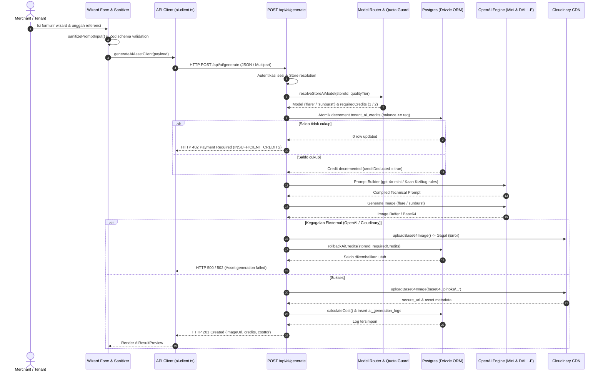

# Arsitektur Pipeline AI UMKM Site Builder

Dokumentasi spesifikasi teknis arsitektur AI Engine, alur data DTO, model tiering, audit ledger saldo token, dan penanganan ketahanan sistem (resilience).

---

## 1. Diagram Alur Data DTO & Siklus Generasi

Pipeline menghubungkan form wizard pada frontend merchant ke backend Astro API, memanggil model OpenAI untuk sintesis visual, mengunggah aset ke Cloudinary CDN, serta mencatat pemotongan ledger secara atomik di Drizzle ORM.



---

## 2. Kebijakan Model Tiering & Alokasi Kuota

Sistem memetakan paket langganan merchant atau permintaan kualitas visual ke engine AI yang tepat:

| Tier / Paket Kuota | Engine Visual AI | Bobot Kredit | Resolusi & Karakteristik | Target Penggunaan |
| :--- | :--- | :---: | :--- | :--- |
| **Trial / Hemat** (`trial`, `hemat`, `fallback`) | `gpt-image-2.5-flare` | **1 Kredit** | Standard Definition, flat vector style, kecepatan generasi tinggi (~5s). | Merchant tahap onboarding, logo monogram dasar, eksplorasi awal. |
| **Reguler / Juragan** (`reguler`, `juragan`, `hd`) | `gpt-image-2.5-sunburst` | **2 Kredit** | High Definition (HD), tekstur 3D photorealistic, detail kemasan tajam, dynamic studio lighting. | Katalog produk unggulan, mockup kemasan premium, poster promosi A3/Instagram. |

### Prinsip Prompt Builder (Kaan Kiziltug Engineering)
- **Zero Hallucination Negative Constraints**: Secara eksplisit melarang teks acak, watermark, gradien buram, atau noise raster pada pembuatan logo.
- **Micro-Detail Preservation**: Pada fitur `packaging_mockup` dan `product_poster`, rasio kontras subjek utama dengan background dikunci minimal 4.5:1 untuk keterbacaan tinggi.

---

## 3. Mekanisme Atomic Balance Deduction & Formula Ledger

### A. Atomic Deduction (Pencegahan Race Condition)
Pemotongan saldo kredit merchant tidak menggunakan mekanisme *read-then-update*, melainkan *single atomic conditional update*:

```sql
UPDATE tenant_ai_credits
SET 
  balance = balance - :requiredCredits,
  total_used = total_used + :requiredCredits,
  updated_at = NOW()
WHERE 
  tenant_id = :storeId 
  AND balance >= :requiredCredits
RETURNING balance;
```
Jika baris yang terdampak adalah 0, sistem langsung menghentikan eksekusi dan melempar `AppError('Kredit AI tidak mencukupi', 402)` sebelum memanggil API eksternal OpenAI berbayar.

### B. Formula Konversi Biaya Token ke Rupiah (IDR)
Audit keuangan internal mencatat pengeluaran riil USD dan ekuivalen IDR pada tabel `ai_generation_logs`.

1. **Komponen Biaya USD ($ Cost_{USD}$)**:
   $$\text{PromptCost}_{USD} = (\text{InputTokens} \times \text{Rate}_{\text{in}}) + (\text{OutputTokens} \times \text{Rate}_{\text{out}})$$
   $$\text{TotalCost}_{USD} = \text{PromptCost}_{USD} + \text{FlatImageCost}_{USD}$$

   *Referensi Nilai Default*:
   - `gpt-image-2.5-flare`: Input \$0.0000025/token, Output \$0.0000075/token, Flat Image: \$0.040 USD.
   - `gpt-image-2.5-sunburst`: Input \$0.000005/token, Output \$0.000015/token, Flat Image: \$0.080 USD.

2. **Konversi ke IDR ($ Cost_{IDR}$)**:
   Kurs aktif diambil dari catatan deposit terakhir di `ai_deposit_history` (fallback: Rp 16.000 / USD).
   $$\text{Cost}_{IDR} = \text{Math.round}(\text{TotalCost}_{USD} \times \text{ExchangeRate})$$

### C. Jaminan Rollback Transaksi
Apabila proses gagal di fase `IMAGE_GENERATOR`, `CLOUDINARY_UPLOADER`, atau `LEDGER_RECORDING`:
```sql
UPDATE tenant_ai_credits
SET 
  balance = balance + :requiredCredits,
  total_used = total_used - :requiredCredits,
  updated_at = NOW()
WHERE 
  tenant_id = :storeId;
```
Memastikan merchant tidak pernah dirugikan akibat kegagalan pihak ketiga (zero credit leakage).

---

## 4. Matriks Penanganan Error HTTP & Resiliensi

| Kode HTTP | Error Code internal | Pemicu (Trigger) | Tindakan & Respons Sistem |
| :---: | :--- | :--- | :--- |
| **400** | `VALIDATION_ERROR` | Payload tidak valid, form kosong, ukuran file referensi > 4MB, atau deteksi injeksi prompt (`sanitizePromptInput`). | Request dihentikan segera sebelum potong kredit. Return pesan panduan spesifik. |
| **401** | `UNAUTHORIZED` | Sesi merchant/user tidak valid atau cookie expired. | Tolak request, arahkan merchant ke halaman login. |
| **402** | `INSUFFICIENT_CREDITS` | Saldo `tenant_ai_credits.balance` < `requiredCredits`. | Return HTTP 402 dengan modal top-up kuota AI Xendit invoice. |
| **413** | `PAYLOAD_TOO_LARGE` | Berkas mentah > 2MB dikirim tanpa kompresi klien. | Frontend menjalankan `compressImageForUpload()` fallback canvas otomatis. |
| **429** | `RATE_LIMIT_EXCEEDED` | OpenAI TPM/RPM rate limit atau proteksi abuse tenant. | Sistem retry otomatis via `exponentialBackoff` dengan jitter (maks 3x coba). |
| **500** | `INTERNAL_AI_ERROR` | Postgres database deadlock, timeout query, atau crash logika server. | Jalankan `rollbackAiCredits()`, catat log error di server. |
| **502 / 503**| `EXTERNAL_SERVICE_DOWN`| OpenAI API outage atau Cloudinary network unreachability. | Rollback saldo otomatis, kirim notifikasi downtime layanan eksternal. |
| **504** | `GATEWAY_TIMEOUT` | OpenAI Image generator memakan waktu > 30 detik. | Abort controller memutus koneksi, rollback kuota, laporkan timeout ke user. |

---

## 5. Direktori Berkas & Tanggung Jawab Modul

- **Frontend & Wizards (Dina)**:
  - `src/components/merchant/ai/ProductLogoWizard.svelte`: Guided input logo tanpa free text injection.
  - `src/components/merchant/ai/ProductPackagingWizard.svelte`: Mockup kemasan produk dengan preview referensi.
  - `src/components/merchant/ai/ProductPosterWizard.svelte`: Desain poster promosi makanan/minuman beraneka rasio.
  - `src/components/merchant/ai/AiResultPreview.svelte`: Tampilan kartu hasil generasi visual beresponsif tinggi.
  - `src/components/merchant/ai/LogoWizardModal.svelte`: Modal wrapper resmi untuk studio visual.
  - `src/lib/client-compressor.ts`: Kompresi sisi klien (< 2MB) menjaga performa upload.
  - `src/lib/security/prompt-sanitizer.ts`: Sanitasi injeksi instruksi, tag HTML, dan karakter kontrol.
  - `src/lib/api/ai-client.ts`: Wrapper pemanggilan endpoint terstandarisasi.
- **Core AI Engine & Ledger (Virda)**:
  - `src/services/ai/prompt-builder.service.ts`: Formulasi prompt berpedoman Kaan Kiziltug.
  - `src/services/ai/logo-generator.service.ts`: Eksekutor sintesis logo via OpenAI.
  - `src/services/ai/product-mockup.service.ts`: Generator mockup kemasan produk.
  - `src/services/ai/product-poster.service.ts`: Generator tipografi & poster promosi.
  - `src/services/ai/model-router.service.ts`: Pemetaan model (`flare` vs `sunburst`) berdasarkan riwayat paket.
  - `src/services/ai/cost-calculator.service.ts`: Perhitungan token-to-IDR dan manajemen kurs deposit.
  - `src/pages/api/ai/generate.ts`: Endpoint orkestrasi pemotongan kredit atomik dan rollback.
